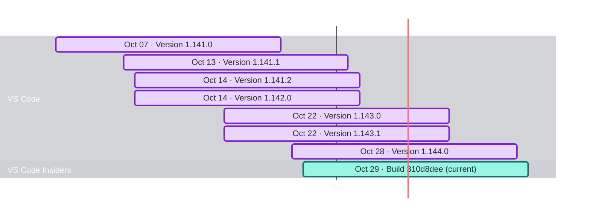

# Visual Studio Code Timeline

Updated: 2026-10-29T12:56:11.0000000+00:00 (UTC)

Roadmap window: **only months with published releases**.

Repository README: [VisualStudioUpdate README](https://github.com/Oxelya-DevTools/VisualStudioUpdate/blob/master/README.md)

## Releases

| Date (UTC) | Channel | Version | Release notes |
| --- | --- | --- | --- |
| 2026-10-29 | VS Code Insiders | Build 310d8dee | [Open](https://github.com/microsoft/vscode/commit/310d8dee3ce083e45c021e23ed5b0dc25c6825eb) |
| 2026-10-28 | VS Code | Version 1.144.0 | [Open](https://github.com/microsoft/vscode/releases/tag/1.144.0) |
| 2026-10-22 | VS Code | Version 1.143.1 | [Open](https://github.com/microsoft/vscode/releases/tag/1.143.1) |
| 2026-10-22 | VS Code | Version 1.143.0 | [Open](https://github.com/microsoft/vscode/releases/tag/1.143.0) |
| 2026-10-14 | VS Code | Version 1.142.0 | [Open](https://github.com/microsoft/vscode/releases/tag/1.142.0) |
| 2026-10-14 | VS Code | Version 1.141.2 | [Open](https://github.com/microsoft/vscode/releases/tag/1.141.2) |
| 2026-10-13 | VS Code | Version 1.141.1 | [Open](https://github.com/microsoft/vscode/releases/tag/1.141.1) |
| 2026-10-07 | VS Code | Version 1.141.0 | [Open](https://github.com/microsoft/vscode/releases/tag/1.141.0) |
| 2026-09-30 | VS Code | Version 1.140.0 | [Open](https://github.com/microsoft/vscode/releases/tag/1.140.0) |
| 2026-09-25 | VS Code | Version 1.139.1 | [Open](https://github.com/microsoft/vscode/releases/tag/1.139.1) |
| 2026-09-23 | VS Code | Version 1.139.0 | [Open](https://github.com/microsoft/vscode/releases/tag/1.139.0) |
| 2026-09-16 | VS Code | Version 1.138.0 | [Open](https://github.com/microsoft/vscode/releases/tag/1.138.0) |
| 2026-09-09 | VS Code | Version 1.137.0 | [Open](https://github.com/microsoft/vscode/releases/tag/1.137.0) |
| 2026-09-08 | VS Code | Version 1.136.2 | [Open](https://github.com/microsoft/vscode/releases/tag/1.136.2) |
| 2026-09-03 | VS Code | Version 1.136.1 | [Open](https://github.com/microsoft/vscode/releases/tag/1.136.1) |
| 2026-09-02 | VS Code | Version 1.136.0 | [Open](https://github.com/microsoft/vscode/releases/tag/1.136.0) |
| 2026-08-26 | VS Code | Version 1.135.0 | [Open](https://github.com/microsoft/vscode/releases/tag/1.135.0) |
| 2026-08-19 | VS Code | Version 1.134.0 | [Open](https://github.com/microsoft/vscode/releases/tag/1.134.0) |
| 2026-08-12 | VS Code | Version 1.133.0 | [Open](https://github.com/microsoft/vscode/releases/tag/1.133.0) |
| 2026-08-11 | VS Code | Version 1.132.1 | [Open](https://github.com/microsoft/vscode/releases/tag/1.132.1) |
| 2026-08-05 | VS Code | Version 1.132.0 | [Open](https://github.com/microsoft/vscode/releases/tag/1.132.0) |
| 2026-07-29 | VS Code | Version 1.131.0 | [Open](https://github.com/microsoft/vscode/releases/tag/1.131.0) |
| 2026-07-22 | VS Code | Version 1.130.0 | [Open](https://github.com/microsoft/vscode/releases/tag/1.130.0) |
| 2026-07-17 | VS Code | Version 1.129.1 | [Open](https://github.com/microsoft/vscode/releases/tag/1.129.1) |
| 2026-07-15 | VS Code | Version 1.129.0 | [Open](https://github.com/microsoft/vscode/releases/tag/1.129.0) |
| 2026-07-14 | VS Code | Version 1.128.1 | [Open](https://github.com/microsoft/vscode/releases/tag/1.128.1) |
| 2026-07-08 | VS Code | Version 1.128.0 | [Open](https://github.com/microsoft/vscode/releases/tag/1.128.0) |
| 2026-07-01 | VS Code | Version 1.127.0 | [Open](https://github.com/microsoft/vscode/releases/tag/1.127.0) |
| 2026-06-24 | VS Code | Version 1.126.0 | [Open](https://github.com/microsoft/vscode/releases/tag/1.126.0) |
| 2026-06-17 | VS Code | Version 1.125.0 | [Open](https://github.com/microsoft/vscode/releases/tag/1.125.0) |
| 2026-06-12 | VS Code | Version 1.124.2 | [Open](https://github.com/microsoft/vscode/releases/tag/1.124.2) |
